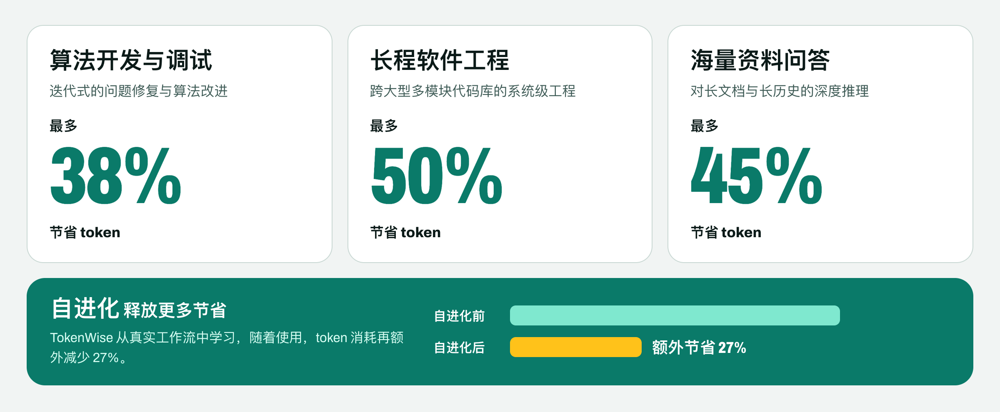
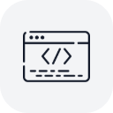
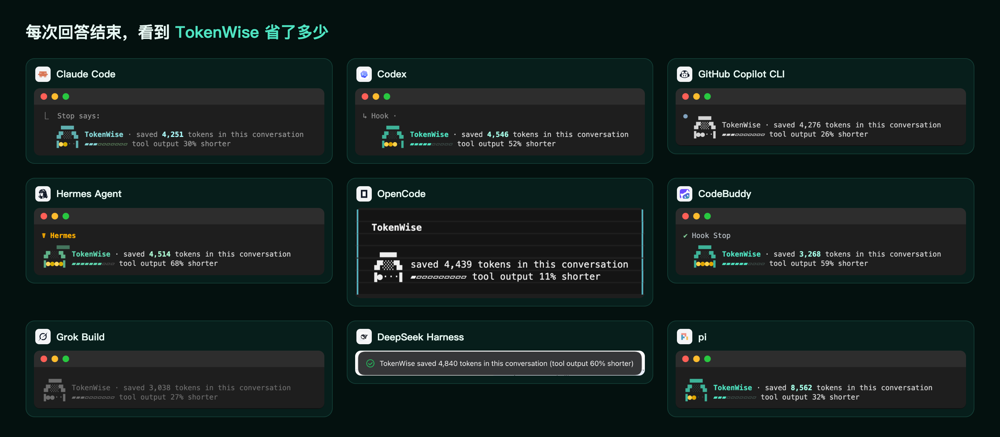
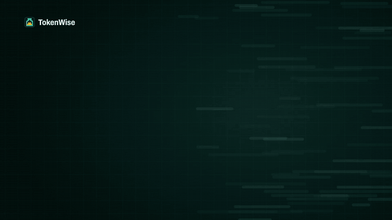

<div align="center">

<h1>
  
  TokenWise：自进化上下文，<br> 最多节省 50% Token
</h1>

<p>
  <a href="../../LICENSE"></a>
  
  <a href="https://github.com/HKUDS/.github/blob/main/profile/README.md"></a>
  <a href="https://github.com/HKUDS/.github/blob/main/profile/README.md"></a>
</p>

[English](../../README.md) · **简体中文**

</div>

<p align="center"></p>

## 为什么需要 TokenWise？

**问题：AI agent 读进去的每个 token 都要付费，包括那些它根本用不上的。**

- 🗑️ **冗余和无关的 token**
  - 重复的指令、日志和工具输出
  - 过时的信息，干扰 agent 的判断

- 📈 **不断增长的 token 成本**
  - 每一次交互，上下文都在变长
  - 每一轮都要为累积下来的历史重新付费

- 🧠 **上下文不会自我进化**
  - 固定规则学不会不断变化的工作流
  - 每个 agent 都从头开始，无法复用已经验证有效的做法

---

### TokenWise 的做法

- ✂️ **少读一些，留住关键。**  
  在噪音到达模型之前把它去掉，同时保留任务所需的关键上下文。

- 🧠 **随每个工作流一起进化。**  
  从真实使用中学习，适应新的工具、命令和上下文。

- 🔄 **学一次，所有 agent 都受益。**  
  在不同 agent 和平台之间共享验证有效的优化策略。

- 📊 **省下的每个 token 都看得见。**  
  实时显示每次回答和累计节省的 token。

## 🤖 即插即用，直接装进你在用的 agent

<table width="100%">
  <tr>
    <td align="center" width="16%"><br><strong>Claude Code</strong></td>
    <td align="center" width="16%"><br><strong>Codex</strong></td>
    <td align="center" width="16%"><br><strong>GitHub Copilot CLI</strong></td>
    <td align="center" width="16%"><br><strong>Hermes Agent</strong></td>
    <td align="center" width="16%"><br><strong>OpenCode</strong></td>
    <td align="center" width="16%"><br><strong>CodeBuddy</strong></td>
  </tr>
  <tr>
    <td align="center" width="16%"><br><strong>Grok Build</strong></td>
    <td align="center" width="16%"><br><strong>DeepSeek Harness</strong></td>
    <td align="center" width="16%"><br><strong>pi</strong></td>
    <td align="center" width="16%"><br><strong>任何 shell</strong></td>
    <td align="center" width="16%"><a href="#接下来"><br><strong>更多接入中</strong></a></td>
  </tr>
</table>


## 🪙 看看 TokenWise 省了多少

**每次回答结束，agent 里都会直接显示省下的 token 数和减少的比例。**

<p align="center"></p>

<sub>结果来自每个 agent 的一次真实运行。</sub>

## 🚀 开始使用

### 让 agent 帮你装（推荐）

把下面这段话粘贴给你的 agent：

```bash
给这台电脑上所有支持的 agent 装上 TokenWise，并逐个确认接入正常。

仓库：https://github.com/HKUDS/TokenWise
```

从下一条命令开始，TokenWise 就会生效，不需要任何配置。

想添加自定义的优化规则，在 agent 里调用 TokenWise：

```bash
/tokenwise          # Claude Code 及其他支持的 agent
$tokenwise          # Codex
@tokenwise          # OpenCode 和 DeepSeek Harness
/skill:tokenwise    # pi
```

### 手动安装

环境要求：**Node.js 22** 和 **pnpm**。

```bash
# 克隆并编译 TokenWise
git clone https://github.com/HKUDS/TokenWise.git
cd TokenWise
pnpm install
pnpm build

# 全局安装 CLI
npm install -g ./packages/cli

# 找到本机的 agent，逐个装上 TokenWise
tokenwise setup

# 验证每个 agent 的接入
tokenwise doctor --probe
```

<p align="center"><a href="https://youtu.be/9p36ZR2rNtE"></a></p>
<p align="center"><sub>▶ <a href="https://youtu.be/9p36ZR2rNtE">在 YouTube 上观看视频</a> · 35 秒</sub></p>

支持 **macOS 和 Linux**。不同 agent 的接入深度不同，详见[各 agent 的接入方式](#各-agent-的接入方式)。

## 接下来
- **更多 agent**：Cursor、Gemini CLI、Kimi Code 等。
- **共享上下文学习**：把验证有效的上下文策略迁移到其他 agent。
- **任务感知的上下文**：针对编程、研究和长时间运行的任务调整上下文。
- **上下文可观测**：展示删掉了什么、保留了什么，以及原因。
- **兼顾效果的优化**：在保留任务关键上下文的同时，节省更多 token。

## 给 agent 读的安装与接入说明

<details>
<summary><strong>逐个 agent 手动安装</strong></summary>
<br>

在源码目录下，先执行 `npm install -g ./packages/cli`，然后：

```sh
pi install "$PWD/adapters/pi"                                   # pi
dsh plugin --profile web add -w "$PWD/adapters/dsh"             # DeepSeek Harness（换成你的 profile）
claude plugin marketplace add "$PWD" && claude plugin install tokenwise@tokenwise
codex plugin marketplace add "$PWD" && codex plugin add tokenwise@tokenwise    # 然后在 /hooks 里信任它的钩子
codebuddy plugin marketplace add "$PWD" && codebuddy plugin install tokenwise@tokenwise
grok plugin marketplace add "$PWD" && grok plugin install tokenwise@tokenwise --trust
copilot plugin marketplace add "$PWD" && copilot plugin install tokenwise@tokenwise

# OpenCode
mkdir -p ~/.config/opencode/plugins
cp adapters/opencode/dist/index.js ~/.config/opencode/plugins/tokenwise.js

# Hermes Agent
mkdir -p ~/.hermes/plugins
cp -R adapters/hermes/tokenwise ~/.hermes/plugins/tokenwise
hermes plugins enable tokenwise && hermes config set context.engine tokenwise

# tokenwise skill：复制到各个 agent 读取 skill 的目录
cp -R skills/tokenwise ~/.claude/skills/            # Claude Code；~/.codebuddy/skills、~/.grok/skills、
                                                    # ~/.config/opencode/skills、~/.hermes/skills、~/.copilot/skills 同理
cp -R skills/tokenwise ~/.agents/skills/            # Codex、pi 和 DeepSeek Harness

# 其他任何 agent 或 shell：用它包一层命令
tokenwise run -c 'cargo test'
```

`tokenwise setup` 会替你执行这些命令；`tokenwise setup --dry-run` 只打印不执行。

</details>

<details>
<summary><strong id="各-agent-的接入方式">各 agent 的接入方式</strong></summary>
<br>

| Agent | 按需读取 | 在 agent 里发起学习 |
|---|---|---|
| pi 1.1+ | 进程内；压缩后的上下文由 TokenWise 生成 | `/tokenwise` 面板 |
| DeepSeek Harness 0.2.x | 进程内；压缩后的上下文由 TokenWise 生成 | 插件页 **Learn now** |
| OpenCode 1.19+ | 进程内；压缩后的上下文由 TokenWise 生成 | `tokenwise learn` |
| Hermes Agent 0.22+ | Python 插件和上下文引擎 | `tokenwise learn` |
| Claude Code 2.1+ | hook；目录跟在 Claude 自己的摘要后面 | `/tokenwise:learn` |
| Codex 0.162+ | hook；目录跟在 Codex 自己的摘要后面 | `$tokenwise learn` |
| CodeBuddy 2.175+ | hook，以及改写已存摘要的 mod | `/tokenwise:learn` |
| Grok Build 1.0+ | hook；目录跟在 Grok 自己的摘要后面 | `/tokenwise:learn` |
| GitHub Copilot CLI 1.0+ | hook；只处理命令输出（对话压缩用 Copilot 自己的摘要） | `tokenwise learn` |
| 任何 agent 或 shell | `tokenwise run`，通过 MCP 取回原文 | `tokenwise learn` |

每个 agent 还会装上 `tokenwise` skill：`/tokenwise`，Codex 里是 `$tokenwise`，OpenCode 和 DeepSeek Harness 里是 `@tokenwise`，pi 里是 `/skill:tokenwise`。各 agent 的细节见 [`adapters/`](../../adapters) 下对应的目录；[docs/adapters.md](../adapters.md) 介绍如何接入新的 agent。

</details>

<details>
<summary><strong>命令</strong></summary>
<br>

| 命令 | 作用 |
|---|---|
| `tokenwise setup [agent...]`、`uninstall [--purge]` | 装进你的 agent，或卸载 |
| `tokenwise saved [--month\|--all]` | 在终端里用像素存钱罐显示 TokenWise 帮你省了多少（`--json` 输出数字） |
| `tokenwise dashboard [--port N] [--no-open]` | 在浏览器里显示同一个存钱罐，省下的越多装得越满 |
| `tokenwise report [--host H] [--session S]` | `saved` 背后的详细数据，按会话或 agent 列出，用于排查问题 |
| `tokenwise checkup` | 它精简了什么、学到的规则、还值得教它的命令 |
| `tokenwise teach "<命令>"`、`teach check\|preview\|keep\|drop` | 在你自己的 agent 里教它处理一条命令 |
| `tokenwise preview "<命令>"` | 这条命令的一次真实输出：原文和模型实际读到的内容 |
| `tokenwise learn --learner L`、`learn status\|cancel` | 在后台开始学习、查看进度、停止 |
| `tokenwise rules [list\|off\|on\|rollback]` | 学到的规则 |
| `tokenwise filters` | 所有内置规则，以及各自保证保留什么 |
| `tokenwise recall <id>` | 取回暂放的原文 |
| `tokenwise run -c '<命令>'` | 让任何命令经过 TokenWise |
| `tokenwise doctor [--probe]` | 每个 agent 里 TokenWise 是否在工作（`--probe`：让每个 agent 跑一条命令来证明），配置，以及每个 agent 支持哪些功能 |

所有地方都可以用 `tw` 代替 `tokenwise`。

</details>

<details>
<summary><strong>配置与隐私</strong></summary>
<br>

不需要任何配置。想调整时写 `~/.tokenwise/config.json`；`TOKENWISE_DISABLE=1` 可以在一次运行里关掉全部功能。每个 `TOKENWISE_*` 设置也可以写成 `TW_*`（`TW_HOME`、`TW_DISABLE`）：Codex 和 DSH 会从它们运行的 shell 里去掉名字带 TOKEN 的变量。

所有内容都留在你的电脑上：原文只有你能读，14 天后自动删除。唯一会离开你电脑的，是你自己发起的学习：学习者就是你自己的 agent，它读到的记录会发给该 agent 的模型服务商，和这个 agent 当初运行命令时一样。设置 `"evidence": false` 就什么都不记录。

</details>

[架构](../architecture.md) · [接入新 agent](../adapters.md) · [更新日志](../../CHANGELOG.md) · [宣传素材](../../media/README.md) · [MIT 许可证](../../LICENSE)

<sub>图标由 Magnific 制作，来自 Flaticon（Icons made by <a href="https://www.magnific.com" title="Magnific">Magnific</a> from <a href="https://www.flaticon.com/" title="Flaticon">www.flaticon.com</a>）。agent 图标归各产品所有，来源见 <a href="../../media/agents/NOTICE.md">media/agents/NOTICE.md</a>。</sub>
